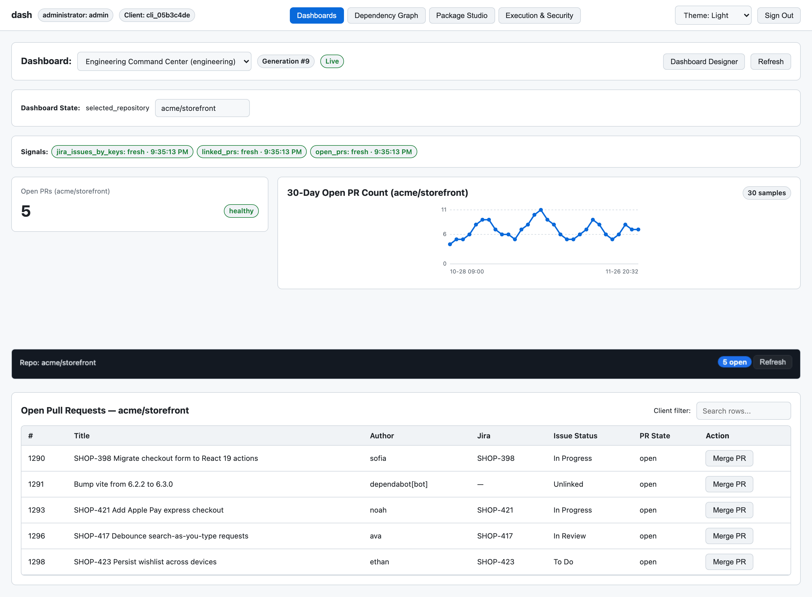
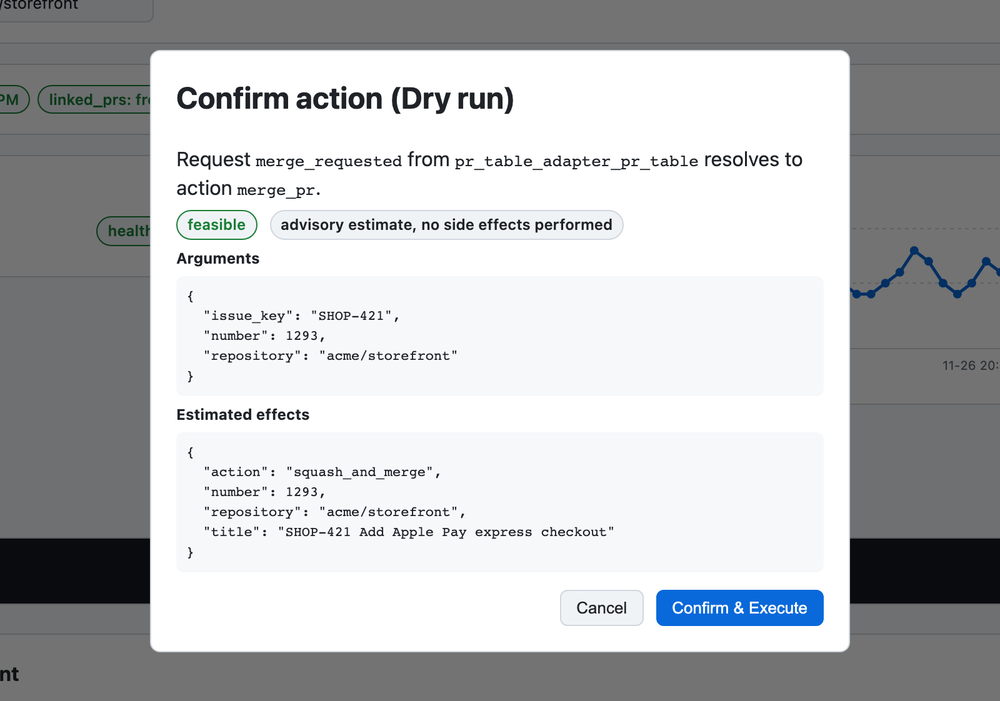
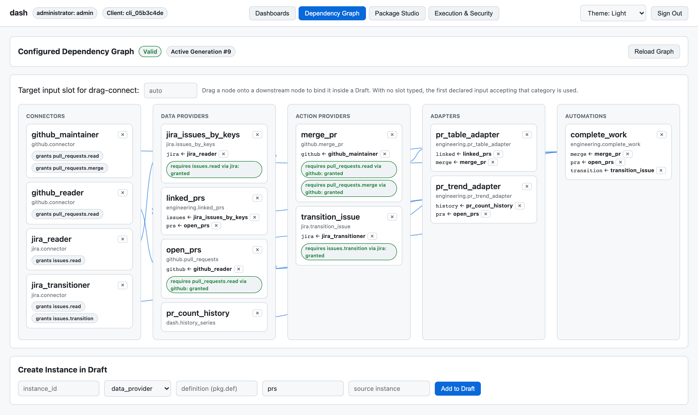
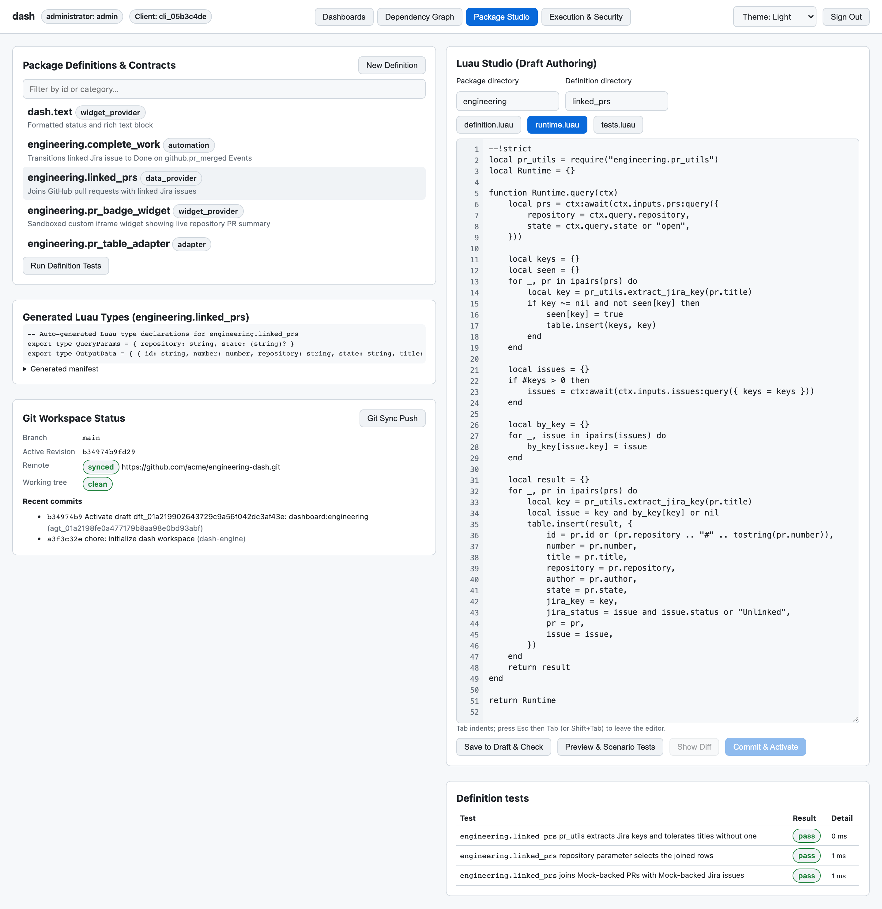
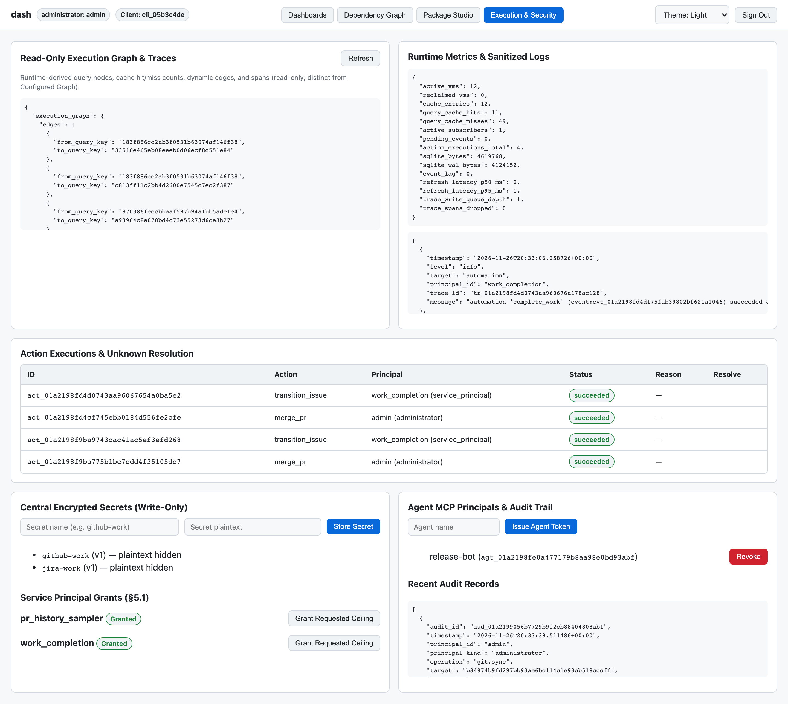

# dash: Universal Dashboard Engine

**A self-hosted dashboard engine in one Rust executable. You and your AI agents can both build and run it.**

dash connects to any API through sandboxed **Luau** extensions. It caches and deduplicates every query, and it streams live updates to the browser. Configuration lives in Git: each change is drafted, tested against mocks, then committed and activated as one atomic step. A built-in visual studio and an authenticated **MCP** server let a human and autonomous agents work on the same dashboards under explicit capability limits.

[1. Overview and screenshots](#1-overview-and-screenshots) · [2. First steps and installation](#2-first-steps-and-installation) · [3. Reference for coding agents](#3-reference-for-coding-agents)

---

## 1. Overview and screenshots

<picture>
  <source media="(prefers-color-scheme: dark)" srcset="docs/screenshots/dashboard-dark.png">
  
</picture>

<sub>The <b>Engineering Command Center</b> reference application, served by <code>dash serve --use-mocks</code>. All GitHub and Jira data comes from fixture-backed Mock connectors, so no real accounts are involved. For these screenshots the demo Workspace adds a third mock repository and 30 days of sampled history. Two PRs were merged through the UI, and an Agent changed the layout over MCP.</sub>

### What it does

| | |
| --- | --- |
| **Compose anything** | Packages of Luau Definitions supply *connectors*, *data providers*, *actions*, *adapters*, *widgets*, *libraries* and *automations*. You wire them into a graph in YAML, in the visual editor or over MCP. |
| **Reactive by default** | Identical queries share one computation (singleflight), and results are cached per authorization context. Updates reach every subscribed widget over WebSocket as snapshots or keyed deltas. If a source fails, the last good value stays visible and is marked `stale`. |
| **Safe actions** | Actions can offer a *Dry run* that runs before anything changes. Each execution is recorded durably and audited. Ambiguous outcomes become `unknown` and are never retried blindly; a `reconcile` handler or an explicit, audited resolution settles them. |
| **Git is the source of truth** | Edits happen in isolated *Draft transactions*. Each draft is validated, run against Mocks in a *Preview* and committed. The new *Generation* is then swapped in atomically. Unchanged Instances keep their VMs, caches and subscriptions. |
| **Agent-native** | 36 MCP tools plus MCP resources let an Agent discover contracts, edit Luau, run tests, activate drafts and invoke actions. It can never go beyond the capability ceiling the Administrator set. |
| **Secure by construction** | Access is denied by default. Capabilities attach to Instances and Principals. Secrets live in an AES-256-GCM vault and are injected by the host, so scripts never see plaintext. Outbound HTTP has SSRF protection, and custom widgets run in CSP-sandboxed iframes. |
| **One-person operations** | One ~26 MiB binary with the UI embedded. It uses SQLite (WAL) and needs no Postgres, Redis or cloud services. It listens on loopback by default and works well behind Tailscale Serve. |
| **Small and fast** | In measured runs on an empty Workspace it starts in ~35 ms and idles at ~23 MiB RSS. It answers warm cached queries in ~4 µs (p95). See [performance gates](#38-performance-gates). |

### A tour of the studio

<table>
  <tr>
    <td width="50%" valign="top">
      <br>
      <b>Dry run before side effects.</b> A widget <i>Request</i> resolves through its Adapter to an action. The host shows the action's advisory estimate before anything happens.
    </td>
    <td width="50%" valign="top">
      <br>
      <b>Dependency Graph.</b> This is the configured graph of connectors, data providers, actions, adapters and automations. It shows granted capabilities inline, and you can drag one node onto another to bind them inside a Draft.
    </td>
  </tr>
  <tr>
    <td width="50%" valign="top">
      <br>
      <b>Package Studio.</b> A Luau editor with generated type declarations, Mock-backed Definition tests, a Draft diff, and Git status with the remote's sync state. The most recent commit was made by an Agent.
    </td>
    <td width="50%" valign="top">
      <br>
      <b>Execution & Security.</b> Shows the runtime execution graph and traces, metrics, the action ledger (including a Service principal's automatic Jira transitions), write-only secrets, grants, Agent tokens and the audit trail.
    </td>
  </tr>
</table>

### Core vocabulary

Every term below has one fixed meaning. The canonical list is in [`GLOSSARY.md`](./GLOSSARY.md).

- A **Package** distributes **Definitions**. An **Instance** is one configured use of a Definition. The **Workspace** is the Git repository that holds all configuration.
- A **Signal** is the one reactive delivery primitive. **State** (persisted and scoped) and **Query results** (derived) both reach consumers as Signals. **Events** are discrete and never coalesced.
- A **Dashboard** places **Adapter** Instances into a layout. Adapters produce trees of **Widget nodes**. Widgets send **Requests**, never Events.
- Every operation runs on behalf of a **Principal**: the **Administrator** (the single human), an **Agent** (one MCP token) or a **Service principal** (background work).
- A **Draft transaction** runs in a **Preview** and then becomes one **Revision** (a Git commit) and one **Generation** (the activated runtime graph).

---

## 2. First steps and installation

### Prerequisites

| Tool | Version | Why |
| --- | --- | --- |
| Rust toolchain | stable, tested with 1.97 | Builds the `dash` binary |
| Node.js and pnpm | Node 25, pnpm 11 | Builds the embedded React UI (`web/`) |
| Git CLI | any recent version | **Needed at runtime.** dash runs `git` to manage the Workspace, Drafts and pushes |

On Apple Silicon or Linux, the full build takes a few minutes the first time and about 30 s after that.

### Quickstart: the reference app on mock data

```bash
git clone https://github.com/egeozcan/dashboard-engine.git
cd dashboard-engine

# 1. Build the UI first, because the release binary embeds web/dist. Then build the binary.
pnpm --dir web install --frozen-lockfile
pnpm --dir web build
cargo build --release --bin dash

# 2. Choose where the Workspace (a Git repo) and the data directory (SQLite, vault) live.
#    Keep both outside this checkout.
export DASH_WORKSPACE="$HOME/dash-demo/workspace"
export DASH_DATA_DIR="$HOME/dash-demo/data"
# Required: this passphrase wraps the secret-vault key (Argon2id). dash will not keep
# a plaintext key next to the encrypted secrets.
export DASH_VAULT_PASSPHRASE='a long, unique vault passphrase'

# 3. Create a Workspace from the reference fixture. A random Administrator password
#    is printed ONCE. To choose your own instead, pass --admin-password (8+ characters).
./target/release/dash init --from-fixture fixtures/engineering-command-center

# 4. Run every Definition test and Scenario test against Mocks. Expect "all_passed": true.
./target/release/dash test

# 5. Start the daemon on http://127.0.0.1:8080 with Mock connectors (no credentials needed).
./target/release/dash serve --use-mocks
```

Open **http://127.0.0.1:8080** and sign in as `admin`. Then try these:

1. **Dashboards.** Change `selected_repository` to `acme/payments` and press Enter. The counter, the trend chart, the custom widget and the table all follow, because they share one parameterized query.
2. Click **Merge PR**. Review the Dry run, then confirm. The table refreshes and the action shows up under **Execution & Security**.
3. On the **Execution & Security** tab, click **Grant Requested Ceiling** for `pr_history_sampler` and `work_completion`. Background work (history sampling, and the automation that moves Jira issues to *Done* after a merge) only runs under Service principals the Administrator has granted.
4. **Package Studio.** Open `engineering.linked_prs` and run its Definition tests. Then edit it, use **Save to Draft & Check**, run **Preview & Scenario Tests**, and click **Commit & Activate**. Run `git -C "$DASH_WORKSPACE" log` to see the new commit.

The rest of this README assumes `dash` is on your `PATH`, for example after `install -m 755 target/release/dash ~/.local/bin/`.

> [!TIP]
> When a daemon is running, other CLI commands use it automatically, for example `dash doctor`, `dash reload`, `dash git status` and `dash secret list`. `dash doctor` reports integrity, the vault, the activation journal, Git sync, storage budgets and pending grants. It exits non-zero when something is wrong.

### Going live: real credentials and the network

Outbound HTTP is **denied** until the Administrator grants a network ceiling. Secrets go into the vault and are bound by name, so they never appear in Git.

```bash
# Read the secret value from stdin so it doesn't end up in your shell history.
# Restrict which Instances may bind it and which host it may be sent to.
printf %s "$GITHUB_TOKEN" | dash secret set github-work \
  --allowed-binding github_reader --allowed-binding github_maintainer \
  --allowed-host api.github.com   # optional: --credential-scheme bearer|basic|key|header:<Name>|query:<param>

dash network show                   # compare what the Workspace requests with what is granted
dash network grant --from-workspace # grant exactly the [network] section of dashboard.toml

dash serve                          # without --use-mocks, the real connectors are used
```

To change configuration on disk, edit the Workspace files (for example `instances/connectors.yaml` → `config.base_url`, or the `[network]` section of `dashboard.toml`). Then run `dash reload`. It turns your working-tree changes into a Draft, then validates, tests, commits and activates it. You can also make the change in the UI or over MCP.

> [!NOTE]
> The GitHub and Jira connectors speak the real APIs: github.com or GitHub Enterprise Server, Jira Cloud (v3) or Server/Data Center (v2). They handle pagination, rate limits and error codes. Every Workspace also includes `dash.fal` for queued inference, `dash.hacker_news` for Algolia HN Search, and `dash.http` for other JSON APIs. See [docs/connectors.md](./docs/connectors.md) for credential schemes, capabilities, operations and examples.

### Private access over Tailscale

```bash
dash serve --bind 127.0.0.1:8080 --allowed-host my-box.my-tailnet.ts.net
tailscale serve --bg 8080
```

- **Host allowlist (protects against DNS rebinding).** Loopback names are always accepted. Add your MagicDNS name with `--allowed-host`, or use `.my-tailnet.ts.net` to accept every subdomain. The allowlist covers the API, `/ws`, `/mcp` and login.
- **Trusted proxies.** Forwarded headers are honoured only from `--trusted-proxy` addresses (default `127.0.0.1`). Login rate limiting uses the forwarded client address, so one tailnet device cannot lock out another.
- **Identity headers are never trusted.** Tailnet membership does not authorize anything, and `Tailscale-User-*` and `X-Forwarded-User` headers are ignored. Argon2id login, CSRF and Origin checks, and scoped Agent tokens are always enforced.
- **Session cookies.** Cookies get `Secure` when the request arrived over HTTPS through a trusted proxy. If your proxy doesn't send `X-Forwarded-Proto`, use `--secure-cookies always`. Tailscale Funnel (public ingress) is not part of the intended deployment.

### Docker

```bash
docker build -t dash:0.2.0 .
docker run --rm -p 127.0.0.1:8080:8080 \
  --user "$(id -u):$(id -g)" \
  -e DASH_ADMIN_PASSWORD='change-me-please' \
  -e DASH_VAULT_PASSPHRASE='a long vault passphrase' \
  -e DASH_INIT_FROM_FIXTURE=/opt/dash/fixtures/engineering-command-center \
  -v "$PWD/my-workspace:/workspace" -v "$PWD/my-data:/data" \
  dash:0.2.0 serve --bind 0.0.0.0:8080 --use-mocks
```

- **First start.** The entrypoint runs `dash init`. Without `DASH_ADMIN_PASSWORD`, it prints a random password once to the container log. Leave out `DASH_INIT_FROM_FIXTURE` to start with an empty Workspace.
- **Bind address.** Inside the container the daemon listens on `0.0.0.0:8080` so that `-p` publishing works. Keep the host side on `127.0.0.1:` so that any wider exposure is a deliberate choice.
- **Vault key.** Supply it in one of three ways: `DASH_VAULT_PASSPHRASE`, `DASH_MASTER_KEY`, or `DASH_MASTER_KEY_FILE` pointing to a separately mounted secret volume. `DASH_ALLOW_COLOCATED_VAULT_KEY=1` explicitly accepts a plaintext key stored next to the data, and `dash doctor` keeps warning about it.
- **Shutdown.** The image runs unprivileged under `tini`, so `docker stop` triggers a graceful drain.
- **TLS proxy on the Docker host.** Pass the proxy's bridge address, for example `--trusted-proxy 172.17.0.1 --allowed-host dash.example.internal`.

### Connect an AI agent (MCP)

```bash
# Issue a scoped, expiring Agent token. It is shown once. Default lifetime is 90d, maximum 365d.
dash token create release-bot --expires-in 30d \
  --ceiling '{"allowed_providers":["*"],"allowed_actions":["merge_pr"],"allowed_connectors":["github_maintainer"],"allowed_capabilities":["pull_requests.read","pull_requests.merge"],"can_author_drafts":true,"can_activate_drafts":true}'
```

**Streamable HTTP:** `POST http://127.0.0.1:8080/mcp` with `Authorization: Bearer dsh_agt_…`.

**stdio**, for clients that start a command. This form proxies to the running daemon:

```json
{
  "mcpServers": {
    "dash": {
      "command": "/path/to/dash",
      "args": ["mcp-stdio", "--url", "http://127.0.0.1:8080/mcp"],
      "env": { "DASH_AGENT_TOKEN": "dsh_agt_…" }
    }
  }
}
```

`mcp-stdio` requires an Agent token. It never acts as the Administrator, and the daemon rejects any non-Agent principal on that transport. To revoke a token, run `dash token revoke <agent_id>` or use the UI.

### CLI reference

Global options are `--workspace <dir>` (`DASH_WORKSPACE`, default `./workspace`) and `--data-dir <dir>` (`DASH_DATA_DIR`, default `./.dash-data`).

| Command | Purpose |
| --- | --- |
| `dash init [--from-fixture DIR] [--admin-password PW] [--reset-admin-password] [--rotate-admin-token]` | Create the Workspace and data directory. It never overwrites existing credentials unless asked to. |
| `dash serve [--bind ADDR] [--use-mocks] [--allowed-host H]… [--trusted-proxy IP]… [--secure-cookies auto\|always\|never] [--shutdown-drain-secs N]` | Run the daemon: UI, REST, WebSocket, MCP and schedulers |
| `dash test` | Run all Definition tests and Scenario tests in an isolated Preview |
| `dash reload` | Turn working-tree edits into a Draft, then validate, test, commit and activate it |
| `dash manifest [DEFINITION_ID]` | Print generated manifests and JSON Schemas |
| `dash doctor` | Run health and integrity diagnostics. Exits non-zero on failure. |
| `dash git status` · `dash git sync` | Show Workspace and remote state, or retry the push |
| `dash secret set NAME [...]` · `dash secret list` | Write-only secret vault |
| `dash token create NAME --ceiling JSON [--expires-in 30d]` · `dash token revoke ID` | Agent MCP tokens |
| `dash grant PRINCIPAL --ceiling JSON` | Grant a ceiling to a Service principal. The **Grant Requested Ceiling** button in the UI does the same thing. |
| `dash network show` · `dash network grant --from-workspace\|--policy JSON` | Administrator network ceiling |
| `dash mcp-stdio [--url URL] [--token T]` | stdio ⇄ Streamable HTTP MCP proxy (Agent tokens only) |

### Environment variables

| Variable | Meaning |
| --- | --- |
| `DASH_WORKSPACE`, `DASH_DATA_DIR` | Workspace and data directory paths |
| `DASH_VAULT_PASSPHRASE` | Wraps `<data_dir>/vault.key` with an Argon2id-derived key. This is the recommended option. |
| `DASH_MASTER_KEY` / `DASH_MASTER_KEY_FILE` | Supply the vault key directly (hex or base64), or as a file outside the data directory. These take precedence over the passphrase. |
| `DASH_ALLOW_COLOCATED_VAULT_KEY=1` | Explicitly accept a plaintext key stored next to the ciphertext |
| `DASH_ADMIN_PASSWORD` | Administrator password for `dash init` |
| `DASH_ALLOWED_HOSTS` | Comma-separated list. Same as `--allowed-host`. |
| `DASH_AGENT_TOKEN` | Agent token for `dash mcp-stdio` |
| `DASH_INIT_FROM_FIXTURE` | Docker only: fixture used to seed the Workspace on first start |
| `RUST_LOG` | Log filter. Default: `dash=info,dash_server=info,dash_core=info`. Logs go to stderr. |

---

## 3. Reference for coding agents

This section is written for AI coding agents and for human contributors who change dash's source code. It explains how the repository is organized, which rules are non-negotiable, and how to verify a change.

### 3.1 Ground rules

1. **Use the glossary's terms.** [`GLOSSARY.md`](./GLOSSARY.md) is authoritative for names in code, APIs, UI text and docs. Each entry lists terms to avoid: say *Instance*, not "plugin instance"; *Definition*, not "plugin"; *Request*, not "widget event"; *Dry run*, not "preview" (for actions). Keep *Revision* (a Workspace commit) separate from *Generation* (an activated runtime graph).
2. **The spec is the contract.** [`specs/dashboard-engine-spec-v0.2.md`](./specs/dashboard-engine-spec-v0.2.md) is the current spec. v0.1 is kept for history only. References like `§12.2` in code comments, tests and messages point to sections of v0.2. Decisions that are hard to reverse are recorded in [`docs/adr/`](./docs/adr/). Items listed in spec §19 ("explicitly open") must not be decided silently. If you resolve one, write down the default you chose in an ADR or in the module docs, as the existing code does.
3. **Invariants from spec §20. Never weaken these:**
   - Deny by default. Authority never grows through nesting, libraries or Agents. Effective authority is the intersection of the Administrator ceiling, the Principal, the Instance grants, the operation and the network policy.
   - No secret plaintext in Git, API responses, MCP, logs, traces, Events or widget messages. Connectors get credential *handles*, and the HTTP broker injects the actual credentials.
   - Reads have no side effects. Data providers can't bind actions, and Adapters can't bind connectors. Both rules are enforced at wiring time.
   - Configuration changes always go through Drafts. Side effects (`action_invoke`) never do.
   - A broken draft never replaces a working Generation. An outcome that can't be proven becomes `unknown` and is never retried blindly.
   - Every queue, cache and table has a bound. Every mutation has an identity, a Principal, an outcome and a trace.
   - Configuration must round-trip through CLI, UI, MCP and Git without drift.
4. **One service layer.** REST, WebSocket, MCP and CLI all call `AppServices` (`crates/dash-server/src/services.rs`). New capabilities belong in that layer or in the core crates, not in a single transport's handler.
5. **Fixture data is load-bearing.** Definition tests, Scenario tests and the Rust acceptance suite assert exact values from `fixtures/engineering-command-center` (for example: 3 open `acme/platform` PRs, PR #42 ↔ `DEV-123`). If you change the fixtures, update every test that depends on them.
6. **Done means green.** Run `cargo fmt --all`, `cargo test --workspace`, `pnpm --dir web test` and `pnpm --dir web typecheck`. If you touched hot paths, also run the release benchmarks (§3.8).

### 3.2 Repository map

```text
apps/dash/                 Single executable: clap CLI, daemon bootstrap, CLI→daemon routing
  src/main.rs
  tests/                   End-to-end suites: ac_01_05 … ac_15_17 (MVP acceptance criteria §17),
                           benchmarks.rs (§15.3 gates), cli_daemon, authority_escalation, …
crates/
  dash-store/              SQLite (WAL) store, migrations, retention/budgets, AES-256-GCM vault, redaction
  dash-luau/               mlua/Luau sandbox: declaration evaluator → manifests, schema → JSON Schema
                           and .d.luau typegen, host API (ctx), VM pool and quotas, Luau test runner
  dash-core/               Domain model, authority/capability broker, HTTP broker (SSRF), query engine,
                           Signals, State, Events, history, actions, automations, telemetry
  dash-git/                Workspace loader/serializer, Package resolution + packages.lock, Draft
                           manager (worktrees, rebase, activation journal, push), Preview + Scenarios
  dash-server/             Axum router + REST, auth, WebSocket, MCP, AppServices, embedded UI
web/                       React 19 + TypeScript + Vite UI (embedded into the binary from web/dist)
  src/views/               DashboardView, GraphEditorView, PackageStudioView, DiagnosticsView
  src/components/widgets/  Built-in widget renderers (dash.table, dash.chart, …), one error boundary per node
  src/lib/                 api.ts (fetch + CSRF), signals.ts (/ws client), clientState.ts (Client State),
                           designer.ts, graphEditor.ts, luau.ts (Studio autocomplete, diagnostics, diffs),
                           widgetFormat.ts, formFields.ts, markdown.tsx (built-in widget helpers)
builtins/catalog.json      Built-in Definitions (11 widget providers with props contracts,
                           dash.history_series); compiled in. Reference: docs/builtin-widgets.md
builtins/luau/             Built-in connectors (dash.http, dash.fal, dash.hacker_news), their Mocks,
                           dash.http_query, dash.http_action and dash.http_util
fixtures/engineering-command-center/   Reference Workspace (§16); the canonical authoring example
specs/                     Product specification (v0.2 current)
docs/adr/                  Architectural Decision Records (also served as MCP resources)
docs/builtin-widgets.md    Props reference for the built-in widgets and dash.history_series
docs/connectors.md         Connector setup, operations, data providers and actions
docs/screenshots/          README images
GLOSSARY.md                Canonical vocabulary (also served as an MCP resource)
Dockerfile, docker/        Optional container image (multi-stage; tini; unprivileged)
.cargo/config.toml         Test env: temp-dir-only vault opt-in, 8 MiB RUST_MIN_STACK
```

### 3.3 Architecture

```text
 Browser UI ─┐                         ┌─ REST  /api/*      (session cookie + X-CSRF-Token, or Bearer)
 CLI ────────┼─▶ host_guard (Host      ├─ WS    /ws        (Signals, dashboard renders, Requests)
 MCP agent ──┘   allowlist, drain) ───▶├─ MCP   /mcp       (Agent Bearer, Mcp-Session-Id)
                                       ├─ /widgets/{def}/… (sandboxed custom widget assets, strict CSP)
                                       └─ /healthz, embedded UI fallback
                                                   │
                                     AppServices (one service layer for all entry points)
                                                   │
   dash-core ── QueryEngine ── SignalHub ── StateManager ── EventLog ── ActionManager ── Automations
       │            │                                                        │
       │       dash-luau VmPool (sandboxed VMs, quotas, ctx host API) ◀──────┘
       │            │
       │       HttpBroker (allowlist ∩ Administrator ceiling, SSRF pinning, credential injection)
       │
   dash-git DraftManager (worktrees → validate → Preview/tests → commit → swap Generation → push)
       │
   dash-store SqliteStore (WAL, vault, journal, executions, audit, traces, history, retention)
```

**Crate dependencies.** `dash-store` and `dash-luau` are leaves. `dash-core` depends on both. `dash-git` depends on core, luau and store. `dash-server` depends on all four. `apps/dash` sits on top of everything.

| Concern | Start reading at |
| --- | --- |
| Principals, ceilings, wiring rules (§2.1, §5.1) | `dash-core/src/authority.rs`, `dash-core/src/model.rs` |
| Query identity, singleflight, cache, staleness, breakers (§6) | `dash-core/src/query_engine.rs` (module docs describe the execution model) |
| Signals, `dash.query/1` envelopes, deltas, coalescing (§6.2, §7.1) | `dash-core/src/signal.rs` |
| Scoped State, CAS, migrations (§8) | `dash-core/src/state.rs` |
| Events, durable log, checkpoints, DLQ (§7.2) | `dash-core/src/events.rs` |
| Action lifecycle, Dry run, `unknown` classification, reconcile (§9) | `dash-core/src/actions.rs` |
| Automations, triggers, retries (§7.3) | `dash-core/src/automations.rs` |
| Outbound HTTP, SSRF, credential injection (§5.2) | `dash-core/src/http_broker.rs` |
| Luau declaration sandbox and contract validation (§4.3) | `dash-luau/src/declaration.rs`, `dash-luau/src/manifest.rs` |
| VM pool, deadlines, memory and instruction budgets, carry-over (ADR-0003) | `dash-luau/src/pool.rs` |
| `ctx` host API surface | `dash-luau/src/host_api.rs` |
| Draft protocol, activation, journal, rebase (§12, ADR-0004) | `dash-git/src/drafts.rs`, `dash-git/src/git_cli.rs` |
| Workspace files ⇄ model | `dash-git/src/workspace.rs` |
| Preview, Mocks, Scenario runner (§4.5, §10.3) | `dash-git/src/preview.rs` |
| Package resolution and `packages.lock` (§4.4) | `dash-git/src/packages.rs` |
| Vault key sources and redaction (§5.2) | `dash-store/src/vault.rs` |
| Retention and size budgets (§13) | `dash-store/src/retention.rs` |
| Auth, CSRF, Origin, trusted proxies (§14.3) | `dash-server/src/auth.rs`, `dash-server/src/context.rs` |
| REST routes, CSP, widget sandbox serving | `dash-server/src/routes.rs` |
| WebSocket protocol | `dash-server/src/ws.rs` (protocol documented in module docs) |
| MCP tools and resources (§11) | `dash-server/src/mcp.rs` |
| CLI ⇄ daemon routing, lock, bootstrap | `apps/dash/src/main.rs` |

### 3.4 Build, run, and test

| Task | Command | Notes |
| --- | --- | --- |
| Build UI | `pnpm --dir web install --frozen-lockfile && pnpm --dir web build` | Must run **before** a release build. `rust-embed` compiles `web/dist` into the binary. |
| Build binary | `cargo build --release --bin dash` | Release builds embed the UI. Debug builds read `web/dist` from disk at runtime, so `pnpm build` alone refreshes it. |
| UI dev loop | `pnpm --dir web dev` | Vite on :5173 with HMR. It proxies `/api`, `/ws`, `/widgets` and `/mcp` to a daemon on `127.0.0.1:8080`. |
| Rust tests | `cargo test --workspace` | About 2 min on an M4 Pro. Uses debug builds, where latency bounds get 10× slack (`debug_slack()` in `apps/dash/tests/common_t4/mod.rs`). |
| One suite | `cargo test -p dash --test ac_11_14` | Integration suites live in `apps/dash/tests/` and `crates/*/tests/`. |
| UI tests | `pnpm --dir web test` / `pnpm --dir web typecheck` | Vitest + Testing Library (jsdom). 57 tests. |
| Format | `cargo fmt --all` | Formatting is clean. Clippy currently reports warnings, so don't add new ones. |
| Benchmarks | `cargo test --release -p dash --test benchmarks -- --nocapture` | Prints one `BENCHMARK_REPORT=` JSON line. Only release builds enforce the §15.3 numbers. |
| Fixture tests | `dash test` (on a Workspace) | Definition and Scenario tests, run exactly as activation runs them |
| Container | `docker build -t dash:0.2.0 .` | Multi-stage: node:25-slim → rust:1.97-slim → debian:trixie-slim |

**Build-time gotchas:**

- `GLOSSARY.md`, `docs/adr/*.md`, `docs/builtin-widgets.md`, `docs/connectors.md`, `builtins/catalog.json`, `builtins/luau/**` and `web/index.html` are pulled in with `include_str!`. After editing them, rebuild so the MCP `dash://docs/*` resources, the built-in catalog and the CSP test pick up the change.
- `.cargo/config.toml` sets `DASH_ALLOW_COLOCATED_VAULT_KEY_IN_TEMP=1`. This only covers vault keys inside the system temp directory, i.e. test `TempDir`s. Running `cargo run -- serve` against a real data directory therefore still needs `DASH_VAULT_PASSPHRASE` or one of the other key sources.
- `RUST_MIN_STACK` is set to 8 MiB because deep Adapter → action → connector chains overflow the default 2 MiB test-thread stack in debug builds. The daemon builds its Tokio runtime with explicit 8 MiB worker stacks.
- Never point a second daemon or an in-process CLI at a data directory a daemon already owns. `dash serve` holds an exclusive lock on `<data_dir>/daemon.lock` and refuses to start twice.

**Where the tests for a change live:**

| Area changed | Tests |
| --- | --- |
| Acceptance behaviour (any §17 criterion) | `apps/dash/tests/ac_01_05.rs`, `ac_06_10.rs`, `ac_11_14.rs`, `ac_15_17.rs`, `acceptance_criteria.rs` |
| Authority and escalation | `apps/dash/tests/authority_escalation.rs`, `crates/dash-server/tests/f6_security.rs` |
| CLI ⇄ daemon, bootstrap | `apps/dash/tests/cli_daemon.rs`, `f6_cli_security.rs` |
| Query and Signal semantics | `crates/dash-core/tests/query_signals.rs`, `nested_admission.rs`, `luau_runtime_integration.rs` |
| Events and automations | `crates/dash-core/tests/w4_events_automations.rs`, `f2_events_automations.rs`, `apps/dash/tests/w4_background.rs`, `f2_background_dispatch.rs` |
| Drafts, activation, migrations | `crates/dash-git/tests/transactions.rs`, `state_migration_activation.rs`, `activation_budgets.rs`, `src/drafts_tx_tests.rs` |
| Built-ins and widget assets | `crates/dash-git/tests/builtin_catalog_and_widget_assets.rs` |
| WebSocket, UI endpoints, shutdown | `crates/dash-server/tests/ws_signals.rs`, `ac07_slow_ws_clients.rs`, `ui_endpoints.rs`, `shutdown_reads.rs` |
| Reference Definitions | `apps/dash/tests/reference_definitions.rs` plus each Definition's `tests.luau` |
| UI | `web/src/**/*.test.ts(x)` (`views.test.tsx`, `ac11.test.tsx`, `f7.test.tsx`, …) |

### 3.5 Workspace format and Luau authoring

A Workspace is a Git repository. The reference Workspace is the canonical, executable example, so copy its patterns.

```text
dashboard.toml          name, git_branch, [network] request (allowed_hosts/methods), [[history]] series
packages.toml           [local] packages = [...]; [dependencies.<name>] git = "...", ref = "..."
packages.lock           resolved commits + tree digests (generated; committed)
instances/*.yaml        connectors:, data:, actions:, adapters:, automations:, service_principals:
dashboards/<id>.yaml    id, title, layout, initial_state, adapters[{adapter_instance, area, query_params}], overrides
packages/<pkg>/package.toml
packages/<pkg>/<def>/definition.luau   declaration (deterministic, no I/O)
packages/<pkg>/<def>/runtime.luau      handlers (run in sandboxed runtime VMs)
packages/<pkg>/<def>/tests.luau        Definition tests (run against Mocks)
scenarios/*.yaml        Scenario tests (run in Preview)
```

**Instance YAML.** Each Instance sets `definition: pkg.def`, `inputs: {slot: instance_id}`, `config: {...}`, `secrets: {slot: secret://name}` and `capabilities: [...]` (connectors only). Automations add `run_as: <service principal>`. A Service principal declares a `ceiling` (`allowed_actions`, `allowed_connectors`, `allowed_capabilities`, `allowed_providers`, `allowed_secrets`). The ceiling stays a *request* until the Administrator grants it.

**Declarations** (`definition.luau` returns one of these):

| Constructor | Key fields (see the fixture for complete examples) |
| --- | --- |
| `dash.connector` | `capabilities`, `credentials`, `operations{name = {required_capabilities, mode = "read"\|"write", args, result}}` |
| `dash.mock` | `["for"] = "<connector id>"`, `fixtures{}`. Preview swaps it in automatically for every Instance of the target connector. |
| `dash.data_provider` | `inputs`, `query`, `output`, `updates{on_demand, subscribe}`, `libraries` |
| `dash.action_provider` | `inputs`, `args`, `result`, optional `dry_run`, `reconcile`, `emits{…durable}`, `invalidates{<data-provider Definition ids>}` |
| `dash.adapter` | `inputs` (data and actions only), `dashboard_state_reads`, `accepts_requests`, `requests{}`, `handler` (render), `on_request` |
| `dash.widget_provider` | `asset` (sandboxed HTML), `props`, `accepts_requests` |
| `dash.library` | `runtime`. Imported with `require("pkg.lib")` and listed in `libraries`. Runs with the importer's authority. |
| `dash.automation` | `inputs`, `triggers{ {kind = "event"\|"cron"\|"signal", …} }` |

- **Built-in widgets:** Adapters render `dash.table`, `dash.chart`, `dash.map`, `dash.counter`, `dash.text`, `dash.form`, `dash.button`, `dash.filter`, `dash.container`, `dash.grid` and `dash.tabs` with no Package. Their props are contracts: a node that breaks one renders as a `WIDGET_CONTRACT_VIOLATION` error node. See [docs/builtin-widgets.md](./docs/builtin-widgets.md) for every prop, the shared value formats, and `dash.history_series` windows and downsampling (`window`, `until`, `bucket_secs`, `aggregate`).
- **Schema builders:** `dash.string()`, `dash.number()`, `dash.integer()`, `dash.boolean()`, `dash.any()`, `dash.enum{…}`, `dash.list(x)`, `dash.optional(x)`, `dash.map(x)`, `dash.object{…}`, and `dash.semantic("ns.type@1", shape)`. You can also pass a semantic type name as a string.
- **Input references:** `dash.connector_ref(id, {required_capabilities})`, `dash.data_ref(id)` and `dash.action_ref(id)`.
- **Validation:** declarations with unknown keys, or that aren't deterministic, are rejected. `dash manifest <id>` shows the generated manifest, the JSON Schema and the Luau types.

**Runtime `ctx`** (`dash-luau/src/host_api.rs`). Which fields exist depends on the category.

- **Fields:** `ctx.inputs.<slot>` exposes `:query(params)` for data providers, `:call(op, args)` for connectors and `:invoke(args, idempotency_key)` for actions. Also available: `ctx.query`, `ctx.args`, `ctx.request`, `ctx.event`, `ctx.config`, `ctx.state` (Instance State `get`/`set`), `ctx.dashboard_state` (Adapters, read-only), `ctx.http:request{method, url, credential, body}` (connectors only, via the broker), `ctx.instance_id`, `ctx.trace_id` and `ctx.now`.
- **Methods:** `ctx:await(h)`, `ctx:await_all{…}`, `ctx:emit(type, payload, durable)`, `ctx:push_snapshot`, `ctx:push_delta`, plus `ctx:fixture(path)`, `ctx:mock_get` and `ctx:mock_set` for Mocks.
- **Sandbox:** no `os`, `io`, `debug`, FFI or native modules, and no `require` outside the libraries that were resolved.

**Definition tests** use `dash.test(name, function(make_ctx) … end)` with `dash.assert` and `dash.assert_eq`. In `make_ctx{query=…, args=…, request=…}`, every input resolves to Mocks.

**Scenario steps** go in `scenarios/*.yaml`. Each step sets exactly one operation key and may add an `assert`:

| Step | Assertable fields |
| --- | --- |
| `query: {instance, params, force_refresh?}` | `status`, `length`, `contains` |
| `dry_run: {action, args}` | `feasible` |
| `invoke_action: {action, args}` | `status` |
| `send_request: {dashboard, adapter, widget_id, request, payload}` | `status` |
| `render_dashboard: {dashboard}` | `contains_text`, `widget` |
| `process_events: {source}` | `transitions` |
| `push_update: {…}` | `status`, `envelope_kind` |
| `set_dashboard_state`, `emit_event`, `inject_failure: {instance, mode, message, remaining}`, `clear_failure`, `advance_time` | (no assertions) |

### 3.6 Interfaces

**REST (`/api`).** Browser mutations need the `dash_session` cookie plus an `X-CSRF-Token` header. Bearer tokens (Agent, or the local admin CLI token) need neither. The local admin CLI token (`<data_dir>/admin.token`) is only accepted from a direct loopback peer with no proxy headers.

| Group | Routes |
| --- | --- |
| Auth | `POST /api/auth/login`, `POST /api/auth/logout`, `GET /api/auth/me` |
| Discover | `GET /api/catalog`, `/api/definitions`, `/api/definitions/{id}/sources`, `/api/contracts/{id}`, `/api/graph` |
| Dashboards | `GET /api/dashboards`, `/api/dashboards/{id}`, `GET\|POST /api/dashboards/{id}/state`, `POST /api/widget-request`, `POST /api/widget-request/dry-run` |
| Runtime | `POST /api/queries/{instance}`, `POST /api/actions/{instance}/dry-run\|invoke`, `GET /api/executions`, `POST /api/executions/{id}/resolve\|cancel` |
| Drafts | `GET\|POST /api/drafts`, `GET\|DELETE /api/drafts/{id}`, `POST …/{validate,preview,rebase,activate}`, `POST …/{definitions,instances,dashboards,dependencies}`, `DELETE …/instances/{iid}`, `POST …/secrets/bind`, `GET …/{graph,diff}`, `POST /api/definitions/{id}/test`, `POST /api/workspace/reload` |
| Diagnostics | `GET /api/diagnostics/{logs,traces,metrics,audits}`, `GET /api/doctor`, `GET /healthz` |
| Git | `GET /api/git/status`, `GET /api/git/history`, `POST /api/git/sync` |
| Admin | `GET\|POST /api/secrets`, `GET\|POST /api/agents`, `POST /api/agents/{id}/revoke`, `GET /api/service-principals`, `POST /api/service-principals/{id}/grant`, `GET /api/network-policy`, `POST /api/network-policy/grant` |

**WebSocket (`/ws`).** Client messages are tagged by `type`: `subscribe_query{instance, params}`, `unsubscribe_query`, `resync_query`, `subscribe_dashboard{dashboard_id}`, `unsubscribe_dashboard`, `set_dashboard_state{dashboard_id, key, value, expected_version?}` and `widget_request`. The server pushes these kinds of message:

- `query_signal`: `dash.query/1` snapshots and keyed deltas. A client that sees a `base_version` gap must resync.
- `state_signal`, `state_updated` and `state_resync`: Dashboard State changes.
- `dashboard_render`: a `dash.render/1` render, sent when State, an upstream Signal or the Generation changes.
- `request_result` and `request_error`: the outcome of a widget Request.
- `subscribed`, `unsubscribed` and `error`: acknowledgements and failures.

Slow clients may skip intermediate values, but the latest value always arrives.

**Widget sandbox.** Custom widgets are served from `/widgets/{definition}/{asset}` with `sandbox allow-scripts` and `connect-src 'none'`, and they talk to the host only through `postMessage` with `dash.widget/1` envelopes. The host rejects any Request whose `widget_id` is unbound, whose Generation is stale, or that the widget doesn't declare.

**MCP (`/mcp`, protocol `2026-07-28`).** Responses are JSON. Notifications receive `202`. Batches are accepted. `initialize` returns a Principal-bound `Mcp-Session-Id`, and `DELETE /mcp` ends the session. `structuredContent` is always an object; arrays are wrapped as `{"items": […]}`. There are 36 tools, each with a JSON Schema:

| Domain | Tools |
| --- | --- |
| Discover | `catalog_search`, `contract_get`, `graph_inspect`, `capability_explain` |
| Drafts | `draft_begin`, `draft_status`, `draft_validate`, `draft_preview`, `draft_test`, `draft_rebase`, `draft_activate`, `draft_abort` |
| Definitions | `definition_create`, `definition_edit`, `definition_test` |
| Instances | `instance_create`, `instance_configure`, `instance_delete` |
| Dashboards | `dashboard_get`, `dashboard_update`, `dashboard_preview` |
| Runtime | `provider_query`, `action_dry_run`, `action_invoke`, `execution_inspect`, `execution_resolve`, `execution_cancel` |
| Diagnostics | `logs_query`, `graph_trace`, `metrics_query` |
| Git | `git_status`, `git_history`, `git_sync`, `dependency_update` |
| Secrets | `secret_list`, `secret_bind` (plaintext is never returned) |

Resources: `dash://manifests`, `dash://definitions/{id}`, `dash://graph`, `dash://graph/dependencies`, `dash://drafts/{id}/validation`, `dash://drafts/{id}/preview-report`, `dash://traces`, `dash://logs`, `dash://metrics`, `dash://docs/{glossary,mcp-tools,adr-*}`.

A typical Agent edit cycle: `draft_begin` → `definition_edit` / `instance_create` / `dashboard_update` → `draft_preview` (Definition and Scenario tests) → `draft_activate`. The result is one commit attributed to the Agent, a carry-over report and the push status. If activation reports a stale base, run `draft_rebase` and test again.

### 3.7 Operational semantics

- **Installation lock.** `dash serve` holds `<data_dir>/daemon.lock` and writes its loopback URL to `daemon.json`. While the daemon runs, `reload`, `git`, `doctor`, `secret`, `token`, `grant` and `network` go through its HTTP API using `admin.token`. Without a daemon, they run in-process under the same lock. Rotate the token with `dash init --rotate-admin-token`.
- **Activation.** Activation follows these steps in order:
  1. Fingerprint the draft tree.
  2. Validate, run the tests and prepare replacement VMs under budget.
  3. Commit with `commit-tree`.
  4. Swap the Generation atomically. Unchanged Instances keep their VMs, caches and subscriptions; downstream Instances are rebuilt and marked `stale`.
  5. Push.

  Each step is recorded in an activation journal (`started → committed → activated → pushed`). At startup, the journal is reconciled against `HEAD`. A failed push leaves the change `active / committed / unsynced`, and `git sync` retries it.
- **Shutdown.** On SIGINT or SIGTERM, dash stops admitting mutations and drains in-flight work for up to `--shutdown-drain-secs` (default 30). Anything it can't prove finished becomes `unknown`. Executions that a crashed process left `queued` or `running` are marked `unknown` (`crash_recovery`) at the next startup.
- **Storage bounds.** Every 5 minutes, dash prunes old data:
  - trace spans after 7 days and audit records after 365 days
  - Events after 30 days (the newest per source is kept)
  - terminal executions after 90 days
  - resolved dead letters, expired sessions and sampled metrics

  The WAL is truncated once it passes 64 MiB. A 1 GiB SQLite budget trims diagnostics first. `dash doctor` reports all of this.
- **Vault key precedence.** `DASH_MASTER_KEY`, then `DASH_MASTER_KEY_FILE`, then `DASH_VAULT_PASSPHRASE` (a wrapped `vault.key`; a legacy plaintext key is re-wrapped in place), and finally a plaintext co-located key, which requires an explicit opt-in. Each secret is encrypted with AES-256-GCM using AAD `<name>:v<version>`.
- **Network policy.** The effective policy is the Workspace `[network]` *request* intersected with the Administrator *ceiling* stored in SQLite, outside the Workspace that Agents can edit. DNS answers are vetted once and the connection is pinned to them. Redirects are re-checked at every hop, and credentials never cross origins.

### 3.8 Performance gates

These are the spec §15.3 gates, measured by `apps/dash/tests/benchmarks.rs` in `--release` mode. The hardware was an Apple M4 Pro (14 cores, 48 GiB, macOS 15.6.1) with rustc 1.97.1. That isn't the reference Linux x86-64 machine, so treat the RSS figure as indicative.

| Gate (§15.3) | Target | Measured |
| --- | --- | --- |
| Fresh daemon startup to `/healthz` | ≤ 2 s | **35 ms** |
| Baseline idle RSS | ≤ 100 MiB | **23 MiB** |
| Warm cached provider query, p95 | ≤ 5 ms | **0.004 ms** |
| Signal to 100 subscribers, p95 | ≤ 100 ms | **0.016 ms** |
| 100 identical concurrent queries | 1 computation | **1** (0.78 ms total) |
| Failure isolation: `while true` loop + 5 of 16 MiB memory hog running | no stall | `/healthz` p95 **0.11 ms**; unrelated query p95 **0.71 ms**; loop interrupted after **1.13 s** |
| Idle VM reclamation (TTL 1 s) | back to baseline | **8 VMs** reclaimed **1.01 s** after last use |
| Live graph swap while 4 readers query | no partial graph | **0 mixed results** across 31,226 queries; activation 215 ms; a failed activation keeps the old Generation |

### 3.9 Known gaps and open items

- Spec §19 items are still open: OS keychain integration, webhook ingress, large-data record batches, contract evolution and Package signature verification. The code documents the defaults it chose. Don't present these as finished features.
- Luau sandboxing runs in-process. It is **not** an OS-level security boundary, and a subprocess worker mode is reserved for hostile Packages (§3.2).
- The GitHub and Jira Packages cover pull requests, issues, comments, search, CI status, Actions runs (GitHub), and JQL search, transitions, comments and issue creation (Jira). Other API areas (reviews, releases, projects, sprints, webhooks) are not covered yet. Build them on `dash.http` or extend the Packages.
- `cargo clippy --workspace --all-targets` reports warnings. Fix them when you touch the code nearby, and don't add new ones.

---

<sub>MIT © 2026. See [LICENSE](./LICENSE).</sub>
